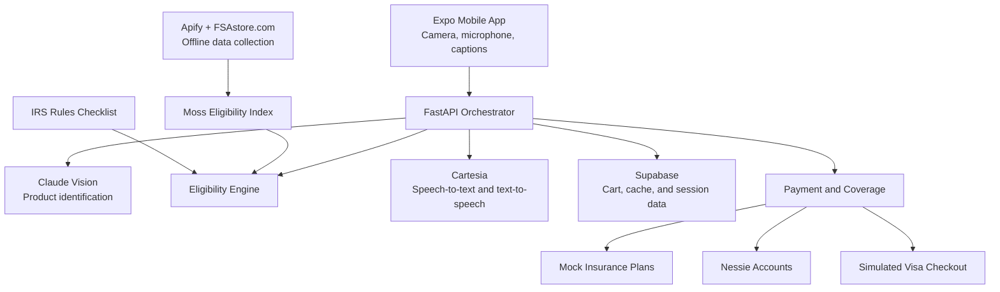

# Rewind

**A voice-first shopping assistant for elderly and low-vision shoppers.**

Rewind helps users identify products, hear prices, check HSA/FSA eligibility, understand possible prescription insurance coverage, and choose the appropriate payment card—all before reaching the register.

## The Problem

Shopping independently can be difficult when product labels and shelf prices are hard to read. Shoppers may also struggle to determine:

- What product they are holding
- How much the product costs
- Whether it is HSA/FSA eligible
- Whether their insurance may cover a prescription
- Which payment card they should use
- Whether their HSA/FSA balance is sufficient

Most checkout systems answer some of these questions only at the register. Rewind provides accessible guidance while the shopper is still in the aisle.

## Problems We Solved

Rewind addresses several challenges in the shopping experience:

- Reads product names, package details, and prices aloud
- Separates everyday products from health-related products
- Checks health products against retailer-listed eligibility data and IRS rules
- Says **“I could not confirm eligibility”** instead of guessing
- Provides mock prescription insurance and copay guidance
- Routes eligible purchases to an HSA or FSA when funds are available
- Suggests a Visa card when an item is not eligible or the health account has insufficient funds
- Groups purchases by payment method for a simulated checkout
- Provides captions, large controls, high contrast, and voice commands

## How It Works

1. The shopper points their phone at a product.
2. Claude Vision identifies the product, category, package details, and visible price.
3. Rewind checks the item against a Moss eligibility index built from FSAstore.com data collected with Apify.
4. IRS category rules provide an additional eligibility checklist and fallback.
5. Prescription items can be checked against a selected mock insurance plan.
6. Nessie provides mock account information and balances.
7. Rewind recommends an HSA, FSA, or Visa card.
8. Cartesia reads the result aloud and listens for the shopper’s response.
9. After confirmation, the item is added to the appropriate cart for simulated checkout.

## Business Perspective

### Target Users

Rewind is designed primarily for:

- Elderly shoppers
- Low-vision shoppers
- People who find small labels, price tags, or checkout interfaces difficult to use
- Caregivers and family members supporting independent shopping

### Value Proposition

Rewind combines accessibility, product understanding, benefit eligibility, insurance guidance, and payment routing in one voice-first experience.

Its main advantage is providing guidance **before checkout**. The user can understand an item and make a payment decision while still standing in the aisle, instead of discovering an eligibility or balance problem at the register.

### Potential Business Model

Rewind could grow through partnerships with:

- Pharmacies and grocery stores
- HSA/FSA account providers
- Insurance and pharmacy-benefit providers
- Senior centers and accessibility organizations
- Retailers improving their accessible-shopping experience

A future version could be offered as a retailer integration, pharmacy pilot, or licensed accessibility platform.

## Technical Perspective

Rewind uses a mobile client with a centralized backend orchestration layer.

- **Frontend:** Expo and React Native
- **Backend:** Python and FastAPI
- **Vision and reasoning:** Anthropic Claude
- **Voice input and output:** Cartesia Ink and Sonic
- **Semantic retrieval:** Moss
- **Eligibility data collection:** Apify
- **Eligibility source:** FSAstore.com retailer-listed data
- **Eligibility fallback:** IRS rules checklist
- **Account management:** Capital One Nessie
- **Payment routing:** HSA/FSA and simulated Visa checkout
- **Insurance:** Mock plan profiles and prescription copay estimates
- **Database:** Supabase
- **Accessibility target:** WCAG 2.2 Level AA

All secret keys remain on the backend. The mobile application communicates with one FastAPI endpoint rather than calling external services directly.

## Architecture



## Run the Project

Requirements: Node 22.13+ or 24.3+, Python 3.12, and **Expo Go (SDK 58)** on an iPhone. Product rules and design decisions live in [`specs/`](specs/).

### Mobile app

```bash
cd app
npm install
cp .env.example .env      # set EXPO_PUBLIC_API_URL to the backend address
npx expo start --tunnel --go
```

Scan the QR code with Expo Go. `--tunnel` works even when the venue Wi-Fi blocks local connections.

If `EXPO_PUBLIC_API_URL` is left empty, the app runs on an offline mock of the demo script (`src/lib/mock-backend.ts`). The mock cannot hear, so it uses fixed answers. Only the real backend reads cards and speaks with Cartesia.

`src/lib/api.ts` is the only file that talks to the backend.

### Backend

```bash
cd backend
python3 -m venv .venv
.venv/bin/pip install -r requirements.txt
.venv/bin/uvicorn main:app --host 0.0.0.0 --port 8000
```

The backend reads its keys from a `.env` file (names only; never commit the values): `ANTHROPIC_API_KEY`, `CARTESIA_API_KEY`, `MOSS_PROJECT_ID`, `MOSS_PROJECT_KEY`, `NESSIE_API_KEY`, `SUPABASE_URL`, `SUPABASE_SERVICE_KEY`, and `APIFY_TOKEN` for the offline data collection only.

### Demo controls

Use **Profile → Demo** in the app to set up the store visit, the account setup, and a declined card, and to reset the demo.

### Checks

```bash
# app
cd app
npx tsc --noEmit
npx expo lint
npx jest
npx expo-doctor
node scripts/contrast-audit.mjs   # WCAG contrast and color-vision check of every theme color

# backend
cd backend
.venv/bin/python -m pytest -q
```

The accessibility audit with measured contrast is in [`app/ACCESSIBILITY.md`](app/ACCESSIBILITY.md).

## Eligibility Pipeline

Rewind uses multiple checks instead of allowing the AI model to guess:

1. Apify collects public, retailer-listed product information from FSAstore.com before the demo.
2. The collected data is cleaned and indexed in Moss.
3. Claude identifies the scanned product and its category.
4. Moss searches for the closest matching product.
5. The backend compares the result with the IRS rules checklist.
6. If the sources agree, Rewind provides an eligibility result.
7. If the product is missing, ambiguous, or conflicting, Rewind says it could not confirm eligibility.

The dataset is retailer-listed information supported by IRS category rules. It is not presented as a complete or officially certified eligibility database.

## Insurance and Payment Flow

Insurance guidance applies only to prescription items handled through the pharmacy flow.

- Rewind reads the prescription name and strength back for confirmation.
- A mock insurance profile is checked for possible coverage.
- A copay estimate is provided only when an exact flat-copay rule is available.
- The user is always asked to confirm the final amount with the pharmacist.
- The insurance-covered portion is never routed to an HSA or FSA.
- Only the shopper’s possible out-of-pocket amount is considered for health-account payment.
- Nessie manages mock account information and balances.
- Visa is used for simulated general-card payments.

Rewind does not file insurance claims or perform real transactions.

## Challenges We Faced

### Natural Voice Responses

Early responses sounded robotic because they combined too many fixed templates. We redesigned the speaker prompt so the assistant responds like a calm helper using one to three short sentences while keeping important information—such as prices and card names—exact.

### Incorrect Eligibility Language

Every product originally received HSA/FSA-related wording, including snacks and drinks. We created everyday-product categories so non-health products are routed directly to the general Visa flow without confusing eligibility language.

### Conversation State

The assistant must remember whether it is waiting for a product, price, confirmation, card choice, or checkout approval. Without this state, unclear input can lead to generic responses or cause the conversation to move to the wrong step.

### Product and Price Lookup

Products not already present in the index can require a slower online lookup or may return no price. Demo products are prepared in advance, and typed product names use a separate fallback that asks the user for the price instead of requesting another photo.

### Vision Reliability

Blur, glare, movement, and partially visible labels can produce unreliable results. Rewind is designed to provide spoken camera guidance such as holding the phone steady or tilting it away from light instead of guessing.

### Latency

Claude reasoning and response composition add time before Cartesia begins speaking. Our target is approximately three seconds from capture to the first spoken audio, so responses are kept short and the first sentence is prioritized.

### Service Integration

Claude, Cartesia, Moss, Nessie, Supabase, and the mobile application all have different response formats, latency limits, and failure conditions. A centralized FastAPI backend provides one shared contract and prevents the mobile application from having multiple competing logic paths.

### Scope Management

The project originally included more agents and integrations than could be made reliable during a hackathon. We removed ASI:One and Agentverse from the final architecture and focused on one dependable mobile workflow.

## Privacy and Safety

- The demo uses mock cards, balances, insurance profiles, and payments.
- Camera frames are processed in memory and are not stored.
- API keys remain on the backend.
- Rewind does not provide dosage, drug-interaction, or medical-safety advice.
- Prescription guidance always ends with a pharmacist confirmation.
- The assistant does not guess when eligibility, price, or product identity cannot be confirmed.

## Current Limitations

- Real-photo testing still needs to be completed across more products and lighting conditions.
- Cartesia volume and phone audio routing require additional device testing.
- The conversation recovery flow needs stronger state-aware prompts.
- Eligibility coverage depends on the products present in the retailer-listed dataset.
- Insurance coverage and copays are simulated estimates.
- Visa checkout is simulated and does not move real money.

## Future Work

- Test with elderly and low-vision users
- Expand product coverage while respecting retailer data policies
- Add reliable state-aware conversation recovery
- Improve camera steadiness detection and spoken framing guidance
- Connect real benefit accounts with user consent
- Pilot Rewind with a local pharmacy or grocery store
- Add reimbursement support for eligible purchases made with another card
